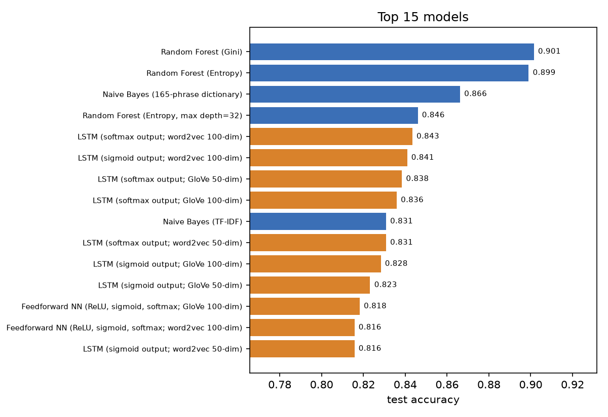
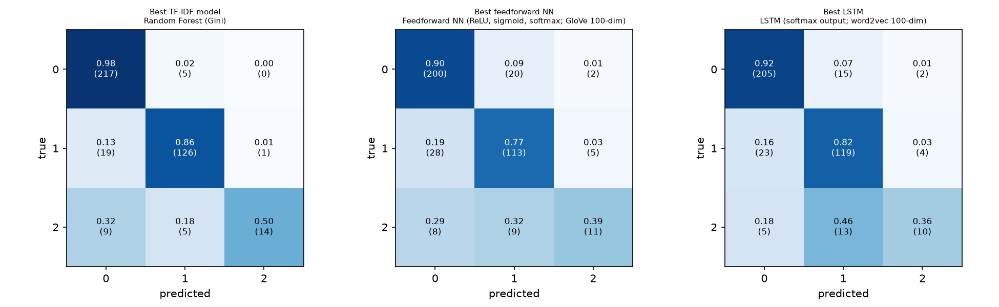

# Classifying Sentiment in the Language of PvP Game Communications
 
**UE24CS352A - Machine Learning, Mini-Project** | Section C | Team 24 | Project 51
 
| Name | SRN |
|---|---|
| Divyanshi Verma | PES2UG24CS161 |
| R P Pranav | PES2UG24CS917 |
 
## Problem statement
Replicate and extend *"Trolls, Haters, or Teammates: Classifying Sentiment in the Language of PvP Game Communications"* (Borst, Yang, Zhu - Stanford, 2021). Given an in-game chat message from Dota 2 or League of Legends, classify it as
 
* **0 - neutral / positive**
* **1 - negative attitude**
* **2 - derogatory**
 
and compare classical machine-learning models on TF-IDF features with neural networks on word2vec / GloVe embeddings.
 
## Dataset
The paper's hand-labelled data set is not public, so we built our own labelled data from the two public sources the paper cites:
 
* **GOSU.AI Dota 2 game chats** (Kaggle) - ~1M messages used, about a third in Russian, the rest mostly English.
* **League of Legends Tribunal chat logs** (Kaggle) - ~1M English messages with case-level report reasons.
 
Pipeline: repair garbled text -> keep unique English messages -> sample 3,400 candidate messages (random + messages likely to be toxic, so that every class appears) -> label the first 2,000 with an AI assistant using written rules -> one of us re-labels 100 messages by hand (without seeing the AI label) to measure label quality and correct mistakes -> stratified 80/20 train/test split.
Label quality numbers are in `results/label_quality.json`.
 
## Models (all from the paper)
| group | models |
|---|---|
| Baseline | binary SVM (linear / RBF / polynomial kernel) |
| TF-IDF | Naive Bayes (165-phrase dictionary and TF-IDF), KNN (K = 1, 2, 3, 6), Random Forest (Gini, entropy, entropy depth 32) |
| Embeddings | feedforward NN (3 activation combinations) and LSTM (softmax / sigmoid output) on word2vec (trained on our chat data) and GloVe (50 and 100 dim) |
 
Evaluation: accuracy, F1 per class, macro-F1, confusion matrices (`results/`).
 
## Repository structure
```
data/raw/          raw Kaggle files (NOT in git - too large, keep them only on your laptop)
data/processed/    candidate messages, labelling prompt, unlabelled corpus for word2vec
data/batches/      labelling batches pasted into the AI assistant
data/responses/    the AI assistant's answers
data/audit/        the manual-check sheet (human labels)
data/labelled/     labelled.csv, train.csv, test.csv
notebooks/         01 data prep | 02 labelling+audit+split | 03 TF-IDF models | 04 embeddings | 05 feedforward NN | 06 LSTM | 07 evaluation
models/            saved vectorizer / best models / embedding matrices used by the demo
results/           result tables, predictions, figures, summary
demo/app.py        Streamlit demo
```
 
## Setup
```bash
git clone <this repo>
cd <repo>
python -m venv .venv
# Windows: .venv\Scripts\activate      Mac/Linux: source .venv/bin/activate
pip install -r requirements.txt
```
Python 3.11 or 3.12 recommended. The notebooks run locally with JupyterLab (`jupyter lab`, then open the notebooks in the `notebooks/` folder).
 
## How to run
1. Put `chatlogs.xlsx` and `dota2_chat_messages.xlsx` into `data/raw/`.
2. Start JupyterLab with `jupyter lab` (virtual environment active) and run the notebooks in order: `01` -> (label with an AI assistant, see the notebook) -> `02` -> `03` -> `04` -> `05` -> `06` -> `07`.
3. Demo (needs the trained models in `models/`, which are committed):
```bash
streamlit run demo/app.py
```
 
## Results
See `results/summary.md` (generated by notebook 07), `results/final_comparison.csv` and the figures in `results/figures/`.

* Labelled dataset: 1979 messages (train 1583, test 396); class share: neutral/positive 56.0%, negative attitude 36.9%, derogatory 7.1%
* Label quality (AI labels vs 97 hand-checked messages): accuracy 0.763, kappa 0.643; 26 labels corrected
* Best model overall: Random Forest (Gini) - accuracy 0.9015, macro-F1 0.8247

### By feature group
| feature_group            |   models |   best_accuracy |   mean_accuracy |   best_macro_f1 |   mean_macro_f1 |
|:-------------------------|---------:|----------------:|----------------:|----------------:|----------------:|
| GloVe (news text)        |       10 |          0.8384 |          0.8142 |          0.7123 |          0.6804 |
| TF-IDF                   |        9 |          0.9015 |          0.7753 |          0.8247 |          0.6488 |
| word2vec (our chat data) |       10 |          0.8434 |          0.8149 |          0.7226 |          0.6688 |

### Top 10 models
|   rank | model                                   |   accuracy |   macro_f1 |
|-------:|:----------------------------------------|-----------:|-----------:|
|      1 | Random Forest (Gini)                    |     0.9015 |     0.8247 |
|      2 | Random Forest (Entropy)                 |     0.899  |     0.8226 |
|      3 | Naive Bayes (165-phrase dictionary)     |     0.8662 |     0.7075 |
|      4 | Random Forest (Entropy, max depth=32)   |     0.846  |     0.7788 |
|      5 | LSTM (softmax output; word2vec 100-dim) |     0.8434 |     0.7226 |
|      6 | LSTM (sigmoid output; word2vec 100-dim) |     0.8409 |     0.7124 |
|      7 | LSTM (softmax output; GloVe 50-dim)     |     0.8384 |     0.7123 |
|      8 | LSTM (softmax output; GloVe 100-dim)    |     0.8359 |     0.6831 |
|      9 | Naive Bayes (TF-IDF)                    |     0.8308 |     0.7513 |
|     10 | LSTM (softmax output; word2vec 50-dim)  |     0.8308 |     0.6531 |




The TF-IDF group has the single best model (Random Forest, accuracy 0.9015, macro-F1 0.8247). The neural networks on word2vec (our chat data) and GloVe are close behind, with best accuracies of 0.8434 and 0.8384, and their averages are higher than TF-IDF's average (about 0.81 against 0.78) because the weaker TF-IDF models drag that average down. Macro-F1 is clearly lower than accuracy for every model, which is expected here because the derogatory class is only 7.1% of the data.

## Contributions
Work was done in sequence: Pranav built the data and TF-IDF part first, then Divyanshi took over the neural-network part.
 
| Part | Pranav | Divyanshi |
|---|---|---|
| Repo setup, README | x | |
| Data collection, cleaning, sampling | x | |
| Labelling (rules + AI labelling) | x | |
| Manual label check (100 messages) | x | |
| Merge labels, quality check, train/test split | x | |
| TF-IDF models (SVM, NB, KNN, RF) | x | |
| word2vec / GloVe embeddings | | x |
| Feedforward NN | | x |
| LSTM | | x |
| Evaluation (metrics, confusion matrices, comparison) | | x |
| Streamlit demo (demo/app.py) | | x |

 
## Reference
Borst, K., Yang, T., Zhu, M. (2021). *Trolls, Haters, or Teammates: Classifying Sentiment in the Language of PvP Game Communications.* Stanford University.
